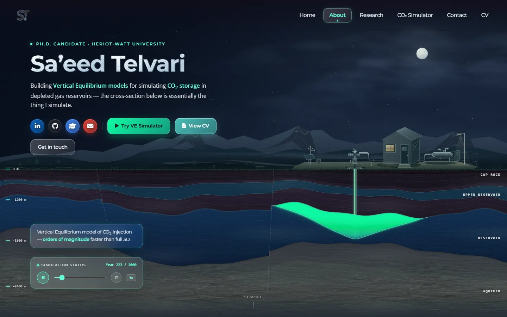
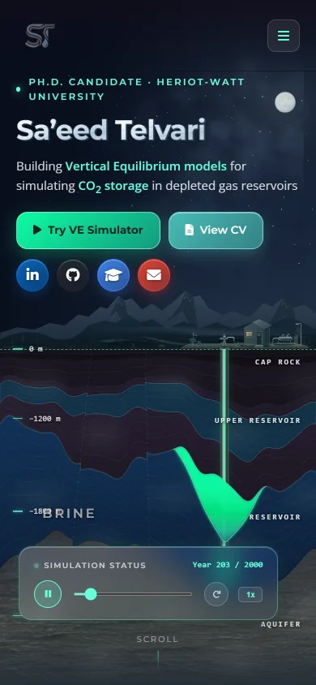

# Homepage audit — 2026-10-13

Scope: the live homepage (`https://saeedtelvari.github.io`, origin/main `b0d87fb`), its hero, sections, header, footer, the CV view (`#cv`) and the shared styles. Evidence comes from the source at `b0d87fb`, headless Chrome (puppeteer-core) at 1440×900 and 390×844 with `prefers-reduced-motion: no-preference`, axe-core 4.10, Chrome DevTools Protocol network and performance counters, and Crossref.

Findings are ranked by impact: **P0** is wrong or broken, **P1** materially hurts first impressions, credibility or speed, **P2** is quality, **P3** is housekeeping.

## Screenshots as they are now

| Desktop 1440×900 | Phone 390×844 |
| --- | --- |
|  |  |

Full pages: [desktop](2026-10-13-homepage-audit/before-home-desktop-full.webp), [phone](2026-10-13-homepage-audit/before-home-phone-full.webp). CV: [desktop](2026-10-13-homepage-audit/before-cv-desktop.webp), [phone](2026-10-13-homepage-audit/before-cv-phone.webp). Also [tablet 834×1112](2026-10-13-homepage-audit/before-home-tablet.webp) and [laptop 1280×720](2026-10-13-homepage-audit/before-home-laptop.webp).

## P0 — wrong or broken

1. **Wrong DOI on a publication.** The SPE Journal paper shows `DOI: 10.2118/218018-PA`. That DOI resolves to *Drill-In Fluid Optimization for Formation Damage Control…* (Tan et al., SPE J. 29(03), 2023). Crossref gives `10.2118/231836-PA` for *Accelerated Permeability Upscaling: A Convolutional Neural Network Approach*, SPE J. 31(04), 2242–2260, published 27 Jan 2026. The homepage also shortens the title to "A CNN Approach", and its BibTeX has no DOI. (`HomeSections.jsx:231-247`)
2. **The hero uses 60 % of a CPU core and never stops.** While it plays, the page spends 570 ms of script per second at the top of the page and 646 ms per second when scrolled 2,500 px away, where the hero is invisible. A 50 ms `setInterval` re-renders the whole scene: 200 reservoir polygons and about a dozen SVG paths, several computed twice per render, each point calling `capRockY`/`stratumY`, which iterate over faults and fault intersections. The JS heap is 61–66 MB. (`SubsurfaceHero.jsx:596-607`, `1696-1960`)
3. **The CV view downloads 6.8 MB and throws an error.** It uses a 6000×4002 px, 4.3 MB JPEG (`assets/headerbg3.jpg`) as a background under an 85 % dark overlay. It also mounts the homepage first, so the six geology textures (2.1 MB) load as well. On phones it logs `Cannot read properties of null (reading 'clientWidth')`: `GeologicalDescent`'s ResizeObserver fires after the component unmounts, when React has already cleared the ref but has not yet run the effect cleanup. Throttled to 1.6 Mbps, 150 ms RTT and 4× CPU, the CV `load` event comes at 37 s. (`CVPage.jsx:9-16`, `GeologicalDescent.jsx:6-28`)
4. **The hero's geology and physics would not satisfy a reservoir engineer.**
   - **The depth axis is not linear.** 0→1200 m covers 120 SVG units, 1200→1800 m covers 160 and 1800→2400 m covers 180, which is 10, 3.75 and 3.3 m per unit. The labels mix depth and elevation ("–1200 m"). (`SubsurfaceHero.jsx:1329-1352`)
   - **The layer labels are wrong.** "Cap rock" labels the whole overburden from the surface down. "Aquifer" labels the rock *below* the storage reservoir, which is underburden: the storage unit is itself the brine aquifer. (`SubsurfaceHero.jsx:1450-1464`)
   - **The plume mixes up stored volume and mobile thickness.** The model tracks CO₂ volume `S` and its historical maximum, and derives the mobile thickness from them, h = (S − R·hmax)/(1 − R). It drives flow with the gradient of `roof + S` and draws the mobile plume to depth `S`. Both should use `h`. The drawn mobile plume is therefore too thick and the residual zone too thin, by up to R·(hmax − h).
   - **Mass is not conserved.** CO₂ leaking up a fault enters the upper reservoir multiplied by **1.5** (`hero-simulation-worker.js:58`, `SubsurfaceHero.jsx:293`). Injection and inflow into a full column are clipped to its capacity, so CO₂ disappears silently.
   - **Injection runs for 320 of 2000 "years".** Storage projects inject for about 20–50 years.
   - **The caption claims more than the section shows.** It says "the cross-section below is essentially the thing I simulate", but the section is CO₂ displacing brine in a saline aquifer. Your research is CO₂–CH₄–brine flow in depleted gas fields.
   - **Nothing says what the colours mean.** There is no legend for mobile versus residually trapped CO₂ or for fault flow.
5. **The navigation highlights the wrong section.** At the top of the page "About" is lit. `App.jsx` compares `offsetTop`, which is relative to the positioned `.geological-descent`, with `window.scrollY`, so every anchor looks reached too early. `Header.jsx` runs a second, competing scroll spy. (`App.jsx:91-113`, `Header.jsx:28-56`)
6. **On tablets the name collides with the role line.** At 834 px the name `h1` (inline-block) sits beside the role line (inline-flex) instead of below it, and overlaps the moon. See the [tablet screenshot](2026-10-13-homepage-audit/before-home-tablet.webp).

## P1 — first impression, credibility, speed

7. **First 5 seconds.** The name, role and topic are readable at once, which is good. The weak points:
   - The loudest things on screen are the neon green CTA and the neon plume.
   - Four saturated brand-colour social circles compete with three CTAs.
   - At 1440 px and 1280 px "Get in touch" wraps onto a row by itself.
   - At 1280×720 the caption box covers the depth labels.
   - Throttled on a phone, the name paints at 3.9 s (LCP 3.7 s, which needs improvement). React and ReactDOM are parser-blocking scripts in `<head>`, so even the loader cannot paint until they have downloaded.
8. **The homepage looks like a different family from the simulator.**
   - Chrome is mint/teal throughout (`#64ffda`, `#4ecdc4`, `#0dfca2`): eyebrow, links, bold text, focus ring, nav pill, dashed horizon, depth ticks, buttons, scrollbar and loader.
   - The page gradient is aubergine → indigo → royal blue (`#211d34 → #1c2645 → #1d416e`). The hero's cap rock is purple (`#2b2336`). The preprint badge is lilac (`#c4b5fd`).
   - The simulator uses neutral warm Earth tokens with amber as the only accent and spends colour on CO₂ classes.
   - The CV is a third look: glass panels over a forest photo, a teal timeline and gold award icons.
9. **Content and copy.**
   - *Publications:* only 2 of 4 papers show until "View more" is clicked, and a four-way topic filter sorts four papers. The "Read abstract" panels are paraphrases, not the abstracts. "100–400×" (SPE paper) does not appear in the published abstract, so keep it only if the paper body states it.
   - *Names don't match:* the simulator is "Try VE Simulator", "Try the VE simulator", "CO₂ Simulator" and "CO₂ Storage Simulator". The degree is "Ph.D. Candidate", "PhD Researcher" and "Doctoral Researcher".
   - *Missing:* no projects section, though the simulator is the strongest project and only appears as a button. Teaching appears only as one activity line. Nothing links to the simulator's Method guide, which cannot be deep-linked.
   - *Noise:* the contact block has a live "22:02 UK Time" clock, "(Verified)" next to ORCID and marketing labels ("GitHub Codebases — Open-Source Solvers & Scientific Repos").
   - *Dead UI:* the "Recent activity" toggle never appears because there are exactly 4 items and the threshold is 4.
10. **Weight.** The homepage moves 2.7 MB:

    | Resource | Size |
    | --- | --- |
    | Geology textures (6 WebP, 1024 px, ~350 KB each) | 2.15 MB |
    | Font Awesome 6.0.0 CSS + 3 webfonts, for ~25 icons | 267 KB |
    | Google Fonts (Montserrat 400–800, Open Sans ×3, plus an Arizonia face that nothing uses) | 137 KB |
    | `bundle.js` (gz) | 49 KB |
    | React (gz) | 47 KB |

    `simulator.html` also downloads all of `bundle.js` (hero, sections, CV) but uses only the header and the app shell. Throttled, the homepage `load` event comes at 15 s.
11. **Sharing and search.**
    - `og:image` for the homepage and the simulator is a stock photo of a jungle waterfall.
    - The only favicon is WebP: there is no `.ico`/PNG fallback and no `apple-touch-icon`.
    - There is no `robots.txt` or `sitemap.xml`, and no `theme-color`.
    - The CV is a hash route (`#cv`), so it cannot have its own title, description or index entry.
    - Without JavaScript the page shows only the loader. There is no `<noscript>` content.
12. **Mobile.**
    - Nothing scrolls horizontally at 390 px.
    - In the hero, "BRINE" overprints the "–1800 m" tick, "UPPER RESERVOIR" sits on the well, the player covers the lower third of the section, and the role line wraps.
    - The page is 7,400 px tall.

## P2 — accessibility and quality

13. **Accessibility.**
    - axe-core reports the footer (`contentinfo`) nested inside `<main>` and, on the CV, an `h2 → h4` heading jump.
    - There is no skip link.
    - The publication filter uses `role="tab"` without tab panels.
    - The hero reset button is named only by `title`.
    - Labels are 9.5–10 px (depth ticks, layer names, "Simulation status", "Scroll").
    - The footer's 12 px affiliation line measures 4.45:1 over the granite texture.
    - Under reduced motion the hero simulation still auto-plays, and content inside `Reveal` stays at `opacity: 0` until it is observed.

    Contrast elsewhere passes (nav 17:1, hero summary 12.6:1).
14. **Code health.**
    - *Dead hero code:* about 300 lines (`Streamlines`, `SimCells`, `PLUME_B1–B5`, `getColumnPath`, `CAP_ROCK_PATH`). A developer name-animation switcher (`?name-preview=`) ships to production.
    - *Duplicated solver:* the solver exists twice, as the worker and as a main-thread fallback copy.
    - *Dead CSS:* about 400 lines in `colors_and_type.css` (`.competency-*`, `.seismic-*`, `.dossier-main-grid`, `.bg-blob-*`, `.glowing-hover-item`, `.publication-card`, `.research-interest-*`), plus about 10 unused keyframes in `index.html`.
    - *Unused primitives:* `GlassCard`, `ResearchIcon`, `SectionTitle`, `Badge`/`BADGE_TINTS`.
    - *Global styles leak:* `h1` gradient text, `strong { color: mint }` and `a { color: mint }` apply to every page that loads `colors_and_type.css`, including the simulator, which has to undo them.
    - *Version drift:* `simulator.html` loads `bundle.js?v=13.2` while `index.html` loads `?v=40.1`, and it loads `colors_and_type.css` unversioned.
    - *Stale files:* `agent_handoff.md` describes an old bug and paths on another machine. `graphify-out/` is committed and contains local machine paths.
    - *Unused images:* about 27 MB in `assets/` (`bg18.png`, `research_bg.png`, `about_bg.png`, …).
15. **Test gaps.** Nothing tests the hero's mass balance, the navigation state, the publication data (DOIs) or the CV route. The site smoke test only matches patterns in source text.

## P3 — housekeeping

16. "Scroll" cue and the dashed mint horizon line add chrome without information.
17. README still describes a "custom liquid glassmorphism design system".

## What works and should stay

- The night-sky Highland scene, the field site above the well, faulted strata with pinch-outs and the well-to-reservoir alignment.
- Running the hero in a Web Worker. Using fault-contact balancing that conserves volume (`balanceFaultContact`, tested).
- The geological-descent idea (scrolling down the page means going down the column) and its tested shared contacts.
- Keyboard focus is visible on every stop, the mobile drawer traps focus, `prefers-reduced-motion` is wired, there is no horizontal overflow, CLS is under 0.02, and the Person JSON-LD is valid.

## Uncommitted drafts in the local checkout (read-only diff)

The local `main` (`1dfccd2`, 26 Aug) holds edits made on 25 Sep in `CVPage.jsx`, `HomeSections.jsx`, `SubsurfaceHero.jsx`, `index.html` and the generated `bundle.js`. Origin later rewrote these files (`c279081 Update portfolio highlights and CV`, 23 Sep, trimmed the CV), so only the *content* below is a candidate to carry over. None of it is on origin/main:

| # | Draft content | Where |
| --- | --- | --- |
| D1 | **Teaching**: Approved Demonstrator, MSc Petroleum Engineering 2026–27 (Formation Evaluation labs Nov 2026; Production Technology PipeSim tutorials Jan–Feb 2027); MRST workshop co-organiser and lead instructor (Feb–Apr 2026, SET-IT); Teaching Assistant during the MSc (Advanced Naturally Fractured Reservoirs; Advanced EOR) | CV |
| D2 | **Research projects**: MuPSI (Clean Energy Transition Partnership: VE models and a 28-case ensemble for the EBN case study on Dutch depleted gas fields, with NORCE, TU Delft and IDAEA-CSIC); 3D fault-detection tool for MRST (signed-distance fault faces on Cartesian and unstructured grids) | CV, news |
| D3 | **Service and leadership**: co-reviewer for *Geophysical Research Letters* (with Prof. Florian Doster); InterPore2026 volunteer; SPE HWU Student Chapter webmaster (chapter won the 2026 SPE Regional Outstanding Student Chapter Award); SET-IT and MuPhi web contributor | CV |
| D4 | **Invited seminar**: IGE GeoEnergy Seminar Series, Feb 2026 | CV, news |
| D5 | **Professional training**: SLB Intersect CCS (five days, Sep 2026); CMG CCUS modelling certificate (Mar 2026) | CV |
| D6 | **Fuller skills**: Rust; TensorFlow, PyTorch, scikit-learn, OpenCV, OpenPNM; Intersect, CMG, PipeSim, Saphir, PVTSim; OpenFOAM, PerGeos, SALOME, MeshLab; Docker, VS Code | CV |
| D7 | **Older honours**: top 2 % national MSc entrance exam; direct graduate admission (Talented Student Office); top 4 % of 140,000+ BSc entrants; NODET | CV, about |
| D8 | **Preprint status**: "Under review, *Geoenergy Science and Engineering*", with an abstract naming the Hugin Formation East field case and "speed-ups of up to 100×" | Publications |
| D9 | **News items**: MSc demonstrator (Sep 2026), MuPSI/EBN case study (Aug 2026), EAGE Energy–AI Nexus hackathon (Jun 2026, "as part of a team"), InterPore2026 talk and preprint (May 2026), MRST workshop (Mar 2026), invited seminar and SPE bursary (Feb 2026), EAGE GET poster (Oct 2025) | Activity |
| D10 | **Copy**: "PhD" (no dots); About text ("I study how injected CO₂ migrates through depleted gas reservoirs, and how to simulate it quickly at field scale…"); hero annotation "up to 100× faster than full 3D simulation"; hero caption "a live, simplified VE simulation"; meta description mentioning MRST and teaching | Hero, About, `index.html` |

Two drafts conflict with origin:

- **SPE Aberdeen bursary:** the draft says "received a £1,000 … Bursary" where origin says "Runner-up … £1,000 awarded".
- **Hackathon:** the draft says "as part of a team" where origin says "Team runner-up".
